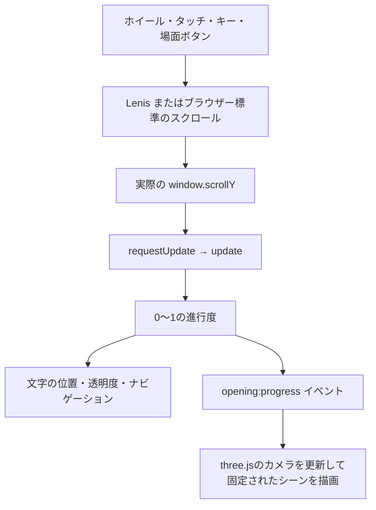

# Scroll Wars

Astro、three.js、Lenisで作った、スクロールで進める宇宙のオープニングです。青い導入文、画面いっぱいのタイトル、画面下から奥へ流れる本文、エンディングの順に表示します。

演出の基準は経過時間ではなく、ページのスクロール位置です。下へスクロールすると先へ進み、上へスクロールすると同じ演出を巻き戻せます。ヘッダーは設けず、星空と文字を画面全体に表示します。

## 操作

- 下へスクロールすると、青い導入文、画面に合わせた大きなタイトル、奥へ流れる本文の順に進みます。
- 上へスクロールすると、同じ位置まで巻き戻ります。
- マウスホイールやトラックパッドにはLenisの慣性スクロールを使い、文字と星空の演出も追従します。タッチ操作はブラウザー標準の慣性を使います。
- 「SCROLL TO BEGIN」でタイトルへ進みます。右側の場面ボタンで導入文、タイトル、本文、エンディングへ移動できます。
- 画面下の「本文を読む」で通常の文章表示へ切り替え、「演出に戻る」で元の進行位置へ戻れます。
- Tabキーで各ボタンへ移動できます。PageDown、PageUp、矢印キーでもスクロールできます。
- OSの動きを抑える設定が有効な場合は、最初から通常の文章表示になります。
- WebGLが使えない場合は静止したSVGの星空を表示します。JavaScriptが無効でも本文を読めます。

## 起動と確認

Node.js 22.12.0以上を使用します。

```sh
npm install
npm run dev -- --background
```

ページは http://localhost:4321 で開けます。

```sh
npm run astro -- dev status
npm run astro -- dev logs
npm run astro -- dev stop
npm run check
npm run build
```

型チェック、ビルド、開発サーバーの初回起動は順番に実行してください。Viteの依存関係キャッシュへの同時書き込みを避けるためです。

本番ビルドの出力先は`dist/`です。ビルド結果をローカルで確認する場合は、開発サーバーを停止してから`npm run preview`を実行します。

## ファイル構成と役割

```text
src/
├── pages/
│   └── index.astro           ページ全体、メタ情報、CSSの読み込み
├── components/
│   ├── OpeningCrawl.astro    各場面、本文表示、操作ボタンのHTML
│   └── Starfield.astro       SVGの星空、WebGL用canvas、周辺の暗がり
├── data/
│   └── story.ts              文章と場面のスクロール配分
├── scripts/
│   ├── opening.ts            スクロール、文字の演出、表示モード
│   └── starfield.ts          three.jsによる星空描画
└── styles/
    └── global.css            配置、色、CSSの遠近法、レスポンシブ表示
astro.config.mjs              開発サーバーの依存関係変換設定
```

文字はHTMLとCSSの3D変形で描き、背景の星だけをthree.jsで描きます。文字をDOMに置くことで、日本語の折り返し、本文の高さの計測、通常の文章表示を同じ文章データから扱えます。three.jsは点を立体空間に配置し、スクロールに連動した奥行きの変化を加える役割です。

## AstroによるHTML生成とブラウザーでの初期化

[index.astro](./src/pages/index.astro)は`story`を読み込み、`Starfield`と`OpeningCrawl`を配置します。Lenisの標準CSSを先に読み込み、その後に`global.css`を読み込みます。

`.astro`の先頭にある`---`で囲まれた部分はHTML生成側の処理です。本番の静的ビルドでは、ここで文章やSVGの星がHTMLになります。ブラウザーでは、各コンポーネント内の`<script>`から次の初期化関数を呼びます。

- [OpeningCrawl.astro](./src/components/OpeningCrawl.astro): `initOpening()`で要素を取得し、演出と操作を登録します。
- [Starfield.astro](./src/components/Starfield.astro): `initStarfield(canvas)`でWebGL描画を準備します。

Astroがこれらのスクリプトとimport先を処理します。ReactなどのUIフレームワークは使用していません。コンポーネントとブラウザースクリプトの扱いは、[Astroのコンポーネントガイド](https://docs.astro.build/en/basics/astro-components/)と[Scripts and event handling](https://docs.astro.build/en/guides/client-side-scripts/)を参照してください。

## スクロールから画面更新までの流れ



### 進行度を0〜1に正規化する

[opening.ts](./src/scripts/opening.ts)の`update()`では、実際のスクロール位置を演出用のスクロール距離`range`で割ります。

```ts
progress = clamp(window.scrollY / range);
```

`progress = 0`が開始位置、`1`が終了位置です。Lenisの目標位置ではなく、ブラウザーの実際の`window.scrollY`を使うため、慣性で動いている間も文字、進行バー、星空が同じ位置に追従します。

各場面では、全体の進行度をその場面専用の0〜1へ変換します。

```ts
const clamp = (value: number) => Math.max(0, Math.min(1, value));
const portion = (value: number, start: number, end: number) =>
  clamp((value - start) / (end - start));
const smoothstep = (value: number) => value * value * (3 - 2 * value);
```

`portion()`は開始前に0、終了後に1を返します。例えば`portion(progress, 0.32, 0.94)`は、本文が流れる区間だけを0〜1に変換します。`smoothstep()`は変化の始まりと終わりを緩やかにし、導入文、タイトル、エンディングのフェードに使います。

### 更新を1フレームにまとめる

ブラウザーの`scroll`イベントとLenisの`scroll`イベントは、どちらも`requestUpdate()`を呼びます。更新予約がすでにある場合は追加予約せず、`requestAnimationFrame()`で次のフレームにまとめて`update()`を実行します。

`update()`の最後では、星空へ進行度と表示モードを渡します。

```ts
window.dispatchEvent(new CustomEvent('opening:progress', {
  detail: { progress, readerMode },
}));
```

このイベントにより、文字のスクリプトからthree.jsのオブジェクトを直接操作せずに、背景を同期できます。

## 場面ごとのスクロール配分

[story.ts](./src/data/story.ts)の`sequence`で、全体に対する開始・終了位置を指定しています。数値は秒数ではなく、スクロール距離に対する割合です。現在の設定は次のとおりです。

- **0〜2%**: 緑色の制作クレジット（Portfolio）を表示してから消します。
- **2〜4%**: 青い導入文が現れ、3.2%から消え始め、4%で消えます。
- **4〜約5.52%**: タイトルが現れます（`titleStart`、`titleFadeInEnd`）。
- **4〜約25.33%**: タイトルは出現と同時に奥へ移動します。20%から透明になり、約25.33%で消えます。
- **約22.29〜54.29%**: 本文が画面下から奥へ流れます。約50.48〜54.29%で消えます。
- **約54.29〜64.95%**: カメラが下を向き、固定された月と惑星が視野に入ります。
- **約66.48〜78.67%**: 宇宙シーンをぼかさず円形に切り抜き、中央へ縮めます。円の外側には、ぼかした惑星のない銀河背景が見えます。円が消えるまでに外側のぼかしも解消します。
- **約80.19〜89.33%**: 前半のプロフィールを順にフェードイン・フェードアウトします。
- **約89.33〜90.10%**: 星空が消え、黒背景へ切り替わります。
- **約90.10〜98.48%**: 黒背景の上で、後半のクレジット全体が下から上へ流れます。
- **約98.48〜100%**: 右側のナビに代わって、場面名だけのナビを画面中央に表示します。各場面名を押すと、そのシーンへ戻ります。

`story.ts`の`titleStoryScrollScale`は`0.5`で、TITLEとSTORYに必要な実際のスクロール距離を半分にしています。タイトル開始4%を維持し、カメラ移動・トランジション・クレジットのスクロール距離も保つよう、全体の距離と各場面の割合を再計算します。`getCameraProgress()`でカメラの進行度を元の配分に戻し、月や惑星の構図を保ちます。

画面右のボタンの移動先は、`opening.ts`の`scenePositions`です。

```ts
const scenePositions = [
  0, sequence.titleFadeInEnd,
  sequence.crawlStart + (sequence.crawlEnd - sequence.crawlStart) * 0.35,
  sequence.creditsStart + creditDuration * 0.35,
  sequence.rollingCreditsStart + (sequence.rollingCreditsEnd - sequence.rollingCreditsStart) * 0.2,
];
```

本文ボタンは本文区間の35%まで進んだ位置へ移動します。開始・終了位置を変更しても、移動先は本文区間内に収まります。最後の場面ボタンは、後半の上へ流れるクレジットへ移動します。

プロフィールの文章とHTMLは[EndCredits.astro](./src/components/EndCredits.astro)で編集します。`<CreditCard>`ひとつが1画面です。内部に`<p>`、`<h2>`、`<br />`などを自由に書けます。画面を増やすには`<CreditCard>`を複製し、表示順を変えるにはブロックを移動します。`label`は読み上げ用の項目名です。クレジット区間は画面数で等分され、フェードもスクロールに連動します。通常の文章表示も同じHTMLを使うので、変更が両方の表示に反映されます。

後半の上へ流れるクレジットは[RollingCredits.astro](./src/components/RollingCredits.astro)で編集します。`.rolling-credits-text`の内部にHTMLを追加してください。各`.rolling-credit-group`はまとまりごとの余白を作ります。文章の高さを測定し、最後の文字が画面上へ抜けるまで移動させます。前半・後半とも通常の文章表示では静止した全文を読めます。

## 画面と文章のサイズを測る処理

`measure()`は、初期化時、画面サイズ変更時、フォントの準備完了時、演出モードに戻る際に実行します。実際に表示される文章の高さを測るため、本文の長さを変えても移動距離を調整できます。

### 必要なスクロール領域

```ts
const scrollLength = Math.max(
  window.innerHeight * sequence.scrollScreens,
  crawlHeight * 3.4 * sequence.scrollDistanceScale,
  rollingScrollLength,
);
journey.style.height = `${scrollLength + window.innerHeight}px`;
range = scrollLength;
```

`scrollScreens`の現在値は`23.625`です。スクロール距離は最低でも画面高さ23.625枚分になり、本文や後半のクレジットが長い場合はさらに伸びます。本文の高さによる距離にも同じ短縮率を適用し、後半のクレジットは表示区間に合わせて必要な距離を計算します。`scroll-journey`にはさらに画面1枚分を足し、ページ末尾での最大スクロール位置が`scrollLength`になるようにしています。

`cinema-stage`は`position: fixed`で画面に固定されています。背後の長い`scroll-journey`がスクロール距離を作り、固定された画面内の文字を進行度に応じて動かす構成です。

画面サイズ変更時には、変更前の進行度を保存し、新しい`range`に対して同じ割合の位置へ戻します。Lenisにも`resize()`を呼び、スクロール可能な距離を再計算させます。`document.fonts.ready`後にも計測し直すことで、フォント確定後の寸法を反映します。

### タイトルを画面いっぱいに合わせる

タイトルのフォントは`Impact, 'Arial Black', sans-serif`です。演出側と通常の文章表示のタイトルに適用し、黄色の輪郭はCSSで描きます。Star Jediのフォント一式と付属ガイドは`src/assets/fonts/star-jedi/`に保存していますが、現在は読み込んでいません。

タイトルはいったん`font-size: 100px`にして高さを測り、画面高さの140%に合わせます。中央に配置し、最初は上下が画面から見切れる大きさにします。フォントの読み込みが完了すると`document.fonts.ready`で寸法を測り直します。

```ts
const titleSize = 100 * height * 1.4 / Math.max(1, title.offsetHeight);
title.style.fontSize = `${titleSize}px`;
```

タイトルの横幅はフォントと文字数に応じて決まります。`story.title`の配列要素は1要素につき1行です。

CSSの`.title-projection`に`perspective: 700px`を指定し、`update()`でタイトルを`translateZ(0px)`から`translateZ(-2800px)`まで動かします。遠近法で徐々に小さくなることと透明度の変化を組み合わせ、奥へ消える演出を作ります。

## 本文が画面下から奥へ流れる仕組み

### 役割を分けた3つの要素

[global.css](./src/styles/global.css)では、次の3段階で遠近法と移動を組み合わせています。

- `.crawl-viewport`: 画面全体を覆い、`perspective`、消失点、上部のフェード用マスクを設定します。
- `.crawl-plane`: 幅`78vw`、上端`85%`の面を、`rotateX()`で奥へ傾けます。回転の中心は面の上端です。
- `.crawl-text`: 傾いた面の上で`translateY()`を変え、文章を手前から奥へ移動させます。

平面の幅は78%ですが、画面下端では遠近法によって約96%に拡大されます。このため、本文が下から現れる時点でほぼ画面いっぱいの幅になります。

### 消失点を画面高さの20%に合わせる

遠近法の距離`perspective`は画面高さの0.78倍とし、360〜850pxに収めます。傾きは通常62度、画面幅500px以下では57度です。

```ts
perspective = Math.max(360, Math.min(850, height * 0.78));
const angle = window.innerWidth <= 500 ? 57 : 62;
const originY = height * 0.2
  + perspective / Math.tan(angle * Math.PI / 180);
```

この面の消失点の縦位置は、`perspective-origin`の縦位置から`perspective / tan(angle)`を引いた位置になります。逆算して`originY`を設定することで、画面の大きさや傾きが変わっても、消失点を上から20%の位置に保ちます。

計算結果は`--crawl-perspective`、`--crawl-angle`、`--crawl-origin`としてCSSへ渡します。これらはJavaScriptが上書きするため、実行時の距離や角度を変える場合は`measure()`を編集してください。

### 本文の移動距離

`crawlProgress`は本文区間の0〜1です。本文の高さと遠近法の距離から、移動量を計算します。

```ts
const startY = perspective * 0.58;
const crawlY = startY
  - (crawlHeight + startY) * crawlProgress
  - perspective * 7 * Math.pow(crawlProgress, 8);
crawl.style.transform = `translateY(${crawlY}px)`;
```

`startY`で本文の開始位置を下へずらし、`(crawlHeight + startY) * crawlProgress`で文章全体を上へ送ります。最後の8乗の項は、序盤にはほとんど影響せず、終盤に最後の段落をさらに奥へ送るための追加距離です。終盤まで本文が手前に残り続けることを防ぎます。

`.crawl-viewport`の`mask-image`は、画面上部22%までは透明、43%までに不透明になるグラデーションです。奥へ小さくなる文字を上部で消し、下から現れる文字にはマスクのフェードをかけません。本文区間全体の開始・終了フェードは、これとは別にJavaScriptで`opacity`を設定しています。

## Lenisの慣性スクロール設定

設定場所は[opening.ts](./src/scripts/opening.ts)冒頭の`scrollSettings`です。現在の値は次のとおりです。変更後はブラウザーを再読み込みしてください。

```ts
const scrollSettings = {
  lerp: 0.04,
  wheelMultiplier: 3,
};
```

### `lerp`: 追従の速さと余韻

`lerp`はスクロール位置が目標位置へ近づく補間の強さです。0より大きく1以下で指定します。小さいほどゆっくり追従して余韻が長くなり、大きいほど素早く追従します。

- `0.04`: 現在の設定。ゆったりした動きです。
- `0.08`: 現在より追従を速める調整例です。
- `0.15`: さらにきびきび反応する調整例です。

これは秒数の指定ではありません。現在の実装は`lerp`で調整しているため、余韻の調整はこの値を変更します。

### `wheelMultiplier`: 入力に対する移動量

ホイール・トラックパッドの入力距離に掛ける倍率です。

- `0.5`: 標準の半分の距離。
- `1`: 標準の距離。
- `3`: 現在の設定。標準の3倍の距離。

「1回の操作で進みすぎる」場合は`wheelMultiplier`を下げ、「止めても長く流れ続ける」場合は`lerp`を上げます。スクロールする総距離は`sequence.scrollScreens`などで決まり、入力倍率とは別に調整します。

### Lenisを生成するときのオプション

`syncScrolling()`で、演出モードかつ動きを抑える設定が無効な場合にLenisを生成します。

```ts
lenis = new Lenis({
  ...scrollSettings,
  autoRaf: true,
  autoResize: false,
  smoothWheel: true,
  syncTouch: false,
  respectReducedMotion: true,
});
```

- `autoRaf: true`: Lenis自身がアニメーションフレームを管理します。アプリ側から毎フレーム`lenis.raf()`を呼ぶ必要はありません。
- `autoResize: false`: アプリの`measure()`でレイアウトを確定した後に、明示的に`lenis.resize()`を呼びます。
- `smoothWheel: true`: ホイール入力を滑らかにします。
- `syncTouch: false`: タッチ操作にはブラウザー標準の慣性を使います。上記の値でタッチ操作の慣性を調整することはできません。
- `respectReducedMotion: true`: 動きを抑える設定を尊重する指定です。アプリ側でも同じ設定を確認し、Lenisの生成・破棄を制御します。

### ボタン移動と位置の復元

場面ボタンは進行度から`value * range`で移動先を求め、`lenis.scrollTo()`を呼びます。この移動にも同じ`lerp`を使いますが、`wheelMultiplier`はホイール入力の倍率なのでボタン移動先の距離を変えません。

画面サイズ変更や表示モード切り替えでは、以前の慣性による移動先を残さないように`lenis.stop()`、`lenis.start()`を呼んでから、`immediate: true`で位置を合わせます。

Lenisがない場合は`window.scrollTo()`を使います。通常のボタン移動は`behavior: 'smooth'`、即時復元や動きを抑える設定が有効な場合は`'instant'`です。

## 星空の描画

### SVGとWebGLを重ねる

[Starfield.astro](./src/components/Starfield.astro)の星空は、下から次の順に重なります。

1. 暗い宇宙の背景色。
2. SVGで描く380個の星。
3. three.jsで描く星、2つの月、惑星の`canvas`（画像の読み込み中はHTML画像で補います）。
4. 画面周辺を暗くする放射状グラデーション。

SVGの星は固定シード`71`の疑似乱数で配置します。HTMLに含まれるため、JavaScriptやWebGLの準備前から星が見えます。WebGLで描画した後はCSSで非表示にし、コンテキストが失われると再表示します。

`canvas`は最初は透明です。WebGLの描画を行った後に親へ`has-webgl`を付け、CSSで表示します。WebGLの初期化に失敗した場合はSVGの星とHTMLの天体画像で表示を続けます。背景全体は`position: fixed`、`pointer-events: none`で、操作ボタンやスクロール入力を妨げません。

惑星は[public/mars_01.png](./public/mars_01.png)をテクスチャにして、月と同じthree.jsシーン内の`THREE.Sprite`で表示します。設定は[src/data/planet.ts](./src/data/planet.ts)です。`position.x`は左右、`position.y`は上下、`position.z`は奥行きで、画像中央の地平線を配置の基準にしています。x・yを大きくすると右・上へ移動し、zをより小さい負の値にすると奥へ移動して小さく見えます。`width`は16:9を基準にした宇宙シーン内の画像の幅です。

[src/scripts/planet.ts](./src/scripts/planet.ts)でカメラの移動に合わせて画像を投影します。初期設定は、カメラが下を向ききったときの地平線を画面高さ90%に合わせています。`horizon`は画像上端から地平線までの割合、`skyFade`は上部の空を透明にする範囲です。縦長の画面では`minAspect`で画像の最小幅を保ち、左右を切り取って画面下まで惑星を表示します。テクスチャの読み込み中とWebGLコンテキストの消失中は、同じ座標・大きさのHTML画像を表示します。WebGLを初期化できない場合も同じ投影を使い、星空はSVGで表示します。惑星はクレジット用の宇宙には表示しません。

大小2つの月は[public/moon02.png](./public/moon02.png)をテクスチャにして、星と同じthree.jsシーン内に配置します。設定は[src/data/moons.ts](./src/data/moons.ts)です。`near`が左の月、`far`が中央の月で、`position.x`は左右、`position.y`は上下、`position.z`は奥行きです。x・yを大きくすると右・上へ移動し、zをより小さい負の値にすると奥へ移動して小さく見えます。`diameter`は宇宙シーン内の直径、`brightness`と`saturation`は明るさと彩度です。xは16:9を基準に画面の縦横比で補正し、狭い画面でも左の月を表示します。

[src/scripts/moons.ts](./src/scripts/moons.ts)でカメラに正対する`THREE.Sprite`を作り、カメラの移動に応じて位置と見かけの大きさが変わります。テクスチャの読み込み中やWebGLコンテキストの消失中は、同じ座標を投影したHTML画像を表示します。WebGLを初期化できない場合も同じ投影を使い、星空はSVGで表示します。月はクレジット用の宇宙には表示せず、惑星と月の両方を円形トランジションに含めます。

月と惑星は宇宙シーンの最初から固定座標に置き、カメラの下向き移動に合わせた表示切り替えやフェードは行いません。スクロール中に動くのはカメラだけです。画面上の位置と大きさはカメラから投影した結果なので、視野の外にある天体はカメラが向いたときに見えます。読み込み中も同じ位置のHTML画像を表示します。

カメラの設定は[src/data/camera.ts](./src/data/camera.ts)です。`panAngle`は下を向く角度で、初期設定の`0.65`ラジアンは約37度です。story中は大小の月と惑星の画像全体が画角の下に収まり、カメラが下を向くと画角へ入ります。下を向ききったときの左の月は画面上から70%、中央の月は40%、惑星の地平線は90%を基準に配置しています。

### three.jsの星の配置

[starfield.ts](./src/scripts/starfield.ts)では、`THREE.Points`にまとめた点群として星を描きます。初期化時の画面幅が600px未満なら850個、それ以外なら1,800個です。この個数は初期化時に決まり、ウィンドウ幅を変えただけでは再生成しません。

固定シード`1204`の疑似乱数で、次の範囲に座標と見た目を設定します。

- X座標: -1,200〜1,200。
- Y座標: -800〜800。
- Z座標: -1,900〜-100。カメラの前方に奥行きを分散します。
- 大きさの属性`aSize`: 1.8〜5.0。
- 明るさの属性`aBrightness`: 0.4〜0.95。

位置、大きさ、明るさは`Float32Array`に格納し、`BufferGeometry`の属性として渡します。星ごとに別のメッシュを作らず、点群をまとめて描画する構成です。

カメラは`PerspectiveCamera(55, 1, 0.1, 2400)`です。画角は55度、縦横比はリサイズ時に更新します。レンダラーは透明な背景、アンチエイリアスなし、`powerPreference: 'low-power'`を指定しています。

### シェーダーで点を星にする

頂点シェーダーは、カメラからの距離に応じて点の表示サイズを決めます。

```glsl
gl_PointSize = clamp(aSize * (500.0 / -viewPosition.z), 1.1, 4.2)
  * uPixelRatio;
```

遠くの星も小さくなりすぎないように1.1〜4.2へ収め、画面のピクセル比を掛けています。`aSize`はこの計算への入力であり、そのまま画面上のpx数になるわけではありません。

フラグメントシェーダーでは、点の中心からの距離で透明度を落とし、四角い点を柔らかい円にします。色は淡い青白色の`vec4(0.83, 0.88, 0.98, alpha)`です。透明度には星ごとの明るさを掛けます。

### スクロールに連動した奥行きの変化

`opening:progress`イベントから受け取った進行度を使い、次の値を変更します。

```ts
camera.position.z = -getCameraProgress(movement) * spaceCamera.travel;
camera.rotation.x = -pan * spaceCamera.panAngle;
```

`movement`は通常は`progress`です。星・月・惑星のシーン内の位置を固定し、カメラの前進と下向きの回転だけで見え方を変えます。`pan`はカメラが下を向く区間の進行度です。通常の文章表示、または動きを抑える設定が有効な場合は`movement = 0`になり、カメラを静止させます。

星はシーン内で静止し、時間で流れ続けたり点滅したりしません。カメラの位置と向きは進行度だけで決まり、スクロールを巻き戻すと背景の見え方も元に戻ります。

### 再描画とリソース管理

WebGLは進行度、画面サイズ、タブの表示状態などが変わったときだけ描画を予約します。同じフレームへの複数の要求はまとめ、非表示タブでは描画しません。Lenis自身の`autoRaf`による処理と、星空の必要時だけの描画は別です。

描画解像度のピクセル比は最大`1.75`に制限し、高密度ディスプレイでの負荷を抑えます。リサイズ時はレンダラーの大きさ、シェーダーのピクセル比、カメラの縦横比を更新します。

WebGLコンテキストが失われると`has-webgl`を外し、SVGの星空だけを表示します。復帰時にはサイズを更新して描き直します。`pagehide`でページが破棄される場合は、イベント、描画予約、Geometry、Material、Rendererを解放します。ブラウザーの履歴キャッシュへ保存される場合は破棄せず、状態を維持します。

## 通常の文章表示とアクセシビリティ

表示モードは`<html>`の`data-mode`で管理します。`cinema`は演出、`reader`は通常の文章表示です。JavaScriptの初期化後に`is-enhanced`クラスを付け、CSSで表示を切り替えます。

JavaScriptが無効な状態では、演出用の領域や操作UIを隠して通常の文章を表示します。文章データは演出と通常表示で共通なので、片方だけ文章が更新されることを避けられます。

`setMode()`で通常表示に切り替えると、演出の進行度を`savedProgress`へ保存し、Lenisを破棄して文章の先頭へ移動します。演出に戻ると寸法を測り直し、保存した割合の位置を復元します。ボタンからの切り替えでは、通常表示の本文または切り替えボタンへフォーカスを移します。

読み上げやキーボード操作には、次の対応をしています。

- 変形する本文には`aria-hidden="true"`を指定し、演出側に読み上げ用の通常の本文を別途用意します。
- 見えなくなった導入文、タイトル、操作可能になる前のエンディングは`inert`で操作対象から外します。
- 切り替えボタンは`aria-pressed`、現在の場面は`aria-current="step"`で示します。
- `aria-live="polite"`の状態表示は、毎フレームではなく場面の切り替わりなどで更新します。
- フォーカス位置に輪郭を表示し、背景の星空は`aria-hidden="true"`で読み上げ対象から外します。

`prefers-reduced-motion`が有効なら初期状態を通常表示にし、設定の変更も監視します。この設定中に手動で演出へ戻ることはできますが、Lenisと星空の視差は無効のままです。文字の遠近法による演出は、その場合もスクロール位置に応じて動きます。

## Astro開発サーバーの設定

[astro.config.mjs](./astro.config.mjs)には、この環境で発生したAstro 7の開発サーバーの起動問題への対策があります。

```text
Unexpectedly unable to find a component instance for route /
```

依存関係の初回変換によってサーバー側のモジュールキャッシュが無効化され、Astroが登録した開発用のページ参照と整合しなくなる問題に対して、ページ処理を準備する前に依存関係の変換完了を待つ設定です。ページのHTMLや演出のロジックとは別の、開発環境のための処理です。

設定は次の2つに分かれます。

1. `vite.environments.ssr.optimizeDeps`で`noDiscovery: true`とし、`picomatch`、`yaml`、`p-queue`を明示的に事前変換します。クライアント側では`lenis`と`three`を指定します。
2. `prepare-server-dependencies`プラグインの`configureServer()`で、SSR側のOptimizerを初期化し、検出済み依存関係の`processing`完了を待ちます。

```js
const optimizer = server.environments.ssr.depsOptimizer;
if (!optimizer) return;
await optimizer.init();
await Promise.all(
  Object.values(optimizer.metadata.discovered).map(dep => dep.processing),
);
```

`enforce: 'pre'`でAstroの処理より前に実行し、`apply: 'serve'`で開発サーバーに限定しています。このプラグインの待機処理は本番ビルドには適用しません。Viteの内部的なOptimizer情報を参照しているため、AstroやViteを更新する際は、依存キャッシュがまだない状態での起動と`/`へのアクセスも確認してください。

## カスタマイズの目安

### 文章と場面の長さ

- [story.ts](./src/data/story.ts)の`story`: タイトル、導入文の日本語・英語、章番号、章タイトル、段落、エンディング。
- 同ファイルの`sequence`: 各場面の開始・終了位置と最低スクロール距離。
- [opening.ts](./src/scripts/opening.ts)の`scenePositions`: ボタンで移動する位置。

場面の数値は開始から終了へ増える順序を保ち、`portion()`に渡す開始値と終了値を同じにしないでください。文章を増やすとスクロール距離は自動で伸びますが、場面ごとの割合は変わりません。

### 色、文字、遠近感

- [global.css](./src/styles/global.css)の`--space`、`--gold`、`--intro-blue`: 背景色、タイトル・本文の色、導入文の色。
- `.opening-title`: フォント、輪郭線、行間。初期の高さは`measure()`の`1.4`で画面高さの140%に合わせます。
- `.crawl-text`: 本文の文字サイズ、行間、段落間隔。
- `.crawl-plane`: 本文の面の幅`78vw`と上端`85%`。幅や上端を変更すると画面下端の見かけの幅も変わります。
- `measure()`の`perspective`、`angle`、`originY`: 遠近感と消失点。
- `.crawl-viewport`の`mask-image`: 奥へ消える文字のフェード位置。

全体のスタイルは[AstroのStyles and CSSガイド](https://docs.astro.build/en/guides/styling/)も参照してください。

### 星空

- [Starfield.astro](./src/components/Starfield.astro)の`length: 380`: SVGの星の数。
- [starfield.ts](./src/scripts/starfield.ts)の`count`: WebGLの星の数。
- 頂点シェーダーの`clamp()`とフラグメントシェーダー: 星の大きさ、色、輪郭の柔らかさ。
- [camera.ts](./src/data/camera.ts)の`travel`、`panAngle`: カメラの前進距離と下向き回転の角度。
- [global.css](./src/styles/global.css)の`.starfield-fallback`、`.has-webgl #starfield`、`.universe-vignette`: 各層の明るさと周辺の暗がり。

星の数はSVGとWebGLで別々に管理しています。星を暗くしすぎるときは、星自体の明るさだけでなく、canvasの透明度や周辺のグラデーションも確認してください。

## 変更後に確認する項目

1. ページ先頭で青い導入文と星が見え、タイトルより先に表示されること。
2. タイトルが画面からはみ出さず、大きく表示されること。
3. 本文が画面下からほぼ全幅で現れ、最後の段落まで奥へ流れること。
4. 上方向へのスクロールで同じ位置に巻き戻り、文字と星空が同期すること。
5. 慣性が残る間の場面ボタン、リサイズ、通常表示への切り替えで位置が乱れないこと。
6. 通常表示から戻ると元の進行度へ戻ること。
7. スマートフォン相当の幅や横長の低い画面でも、文字と操作UIが収まること。
8. 動きを抑える設定、JavaScript無効、WebGLを利用できない環境で本文と星空が表示されること。

TypeScriptやAstroのコードを変更した場合は`npm run check`、本番出力に影響する変更では`npm run build`も実行します。READMEの数値は現在の実装に合わせています。設定を変更した場合は、対応する説明も更新してください。
